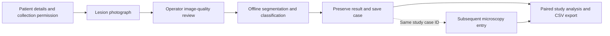
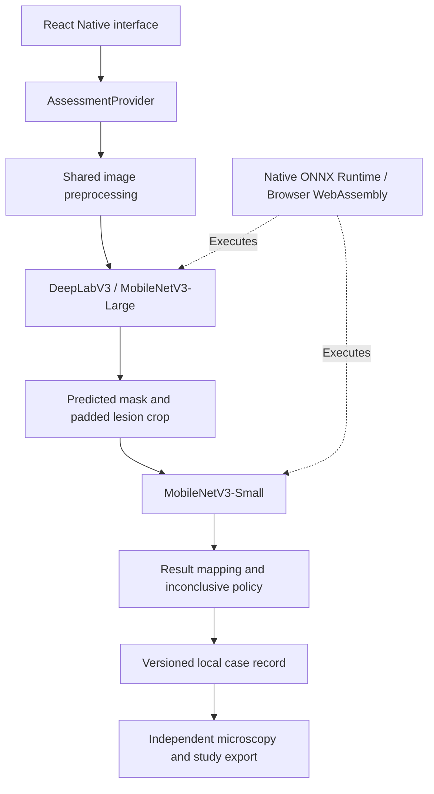

# CLARA

### Offline medical imaging and digital health research for cutaneous leishmaniasis

CLARA integrates lesion segmentation, image classification and structured case documentation within an offline mobile research workflow. Designed around the work of consultants, medical officers and technicians in Pakistan, it supports the systematic investigation of smartphone-assisted cutaneous leishmaniasis (CL) assessment in resource-constrained settings.

The system connects model development with application engineering and study-data management: a lesion photograph is analysed locally, the original model output is preserved, and subsequent microscopy findings can be recorded independently against the same case identifier. This separation supports reproducible comparison between computational assessment and laboratory findings while keeping the patient encounter concise.

**[Android releases](https://github.com/Faisalhakimi22/CLARA-AI-powered-offline-mobile-app-to-support-community-of-cutaneous-leishmaniasis/releases) · [Study methodology](docs/FEASIBILITY_STUDY.md) · [Model evaluation](training/reports/refined_v2_test/review.md) · [Engineering verification](QA.md)**

| Project dimension      | Implementation                                                             |
| ---------------------- | -------------------------------------------------------------------------- |
| Research application   | Feasibility of offline, smartphone-assisted CL assessment                  |
| Computational approach | Lesion segmentation followed by masked-region classification               |
| Execution              | Bundled ONNX models; native runtime and browser WebAssembly                |
| Study linkage          | Preserved image-model result paired with independently recorded microscopy |
| Software               | React Native, Expo, TypeScript, PyTorch and ONNX Runtime                   |
| Current release        | Application 1.1.1 · model pair `clara-local-research-refined-v2`           |

> **Intended use:** CLARA is a research application. Its outputs support investigation of a digital assessment workflow and do not establish a diagnosis. Clinical and laboratory confirmation remain part of the appropriate care pathway.

## Research rationale

The central research question is whether a compact, locally executed image-analysis system can be incorporated into frontline case documentation and evaluated against subsequent laboratory findings. CLARA provides the technical foundation for that investigation: image acquisition, computational assessment, persistent records, model-version attribution and structured study export.

The implementation addresses three connected requirements:

- **Operational independence:** inference and case storage operate locally, without a remote inference service or application backend.
- **Analytical traceability:** the recorded image result retains its model version, timestamp, operator attribution and analysis-attempt timing; laboratory observations are stored separately.
- **Explicit outcome accounting:** conclusive predictions, inconclusive outputs, unavailable analyses and missing laboratory results remain distinguishable in the study dataset.

## Clinical research workflow



The patient-visit workflow ends when the case is saved. Optional clinical information is collected once and does not modify the image-model result. Microscopy is performed through the study's laboratory process and entered later in the separate Study workflow. Image-quality review is an operator assessment of focus, lighting and framing.

The application reports **Suggestive of CL**, **Non-suggestive of CL** or **Inconclusive**. A runtime failure is recorded as **Analysis unavailable**, with no inferred disease label. The current workflow does not introduce a referral action, treatment recommendation or adaptive clinical questionnaire.

### Application capabilities

| Domain                 | Implemented capability                                                                                                  |
| ---------------------- | ----------------------------------------------------------------------------------------------------------------------- |
| Case intake            | Unique study identifiers, optional demographic and clinical information, collection permission and recorder attribution |
| Image acquisition      | Camera and gallery input, preview and retake, illustrated capture guidance and quality acknowledgement                  |
| Local assessment       | Sequential segmentation and classification, lesion-outline display, explicit uncertainty and retry handling             |
| Case management        | Saved and incomplete cases, search, filters, case summaries and persistent photographs                                  |
| Study records          | Separate microscopy entry, original-result preservation and model-version-specific comparison                           |
| Research export        | CSV containing paired and unpaired records, outcome-eligibility flags and spreadsheet-formula protection                |
| Field-facing resources | Offline image-taking guidance and prevention information adapted to the application's Pakistan context                  |

## Computational architecture

The image pipeline uses **DeepLabV3 with a MobileNetV3-Large backbone** for lesion segmentation and **MobileNetV3-Small** for binary classification. The predicted lesion mask defines the region supplied to the classifier.



### Model integration boundary

[`src/services/modelAdapter.ts`](src/services/modelAdapter.ts) exposes a provider-neutral contract consumed by the assessment workflow:

```ts
interface AssessmentProvider {
  segmentLesion(image: LesionImage): Promise<SegmentationResult>;
  classifyLesion(image: LesionImage, segmentation: SegmentationResult): Promise<AIResult>;
}
```

This boundary permits future model replacement without coupling screens to a particular inference engine. Preprocessing and result mapping are shared across platforms; native and browser execution are isolated in their respective runtime modules. Model sessions are loaded lazily, and per-assessment mask state is isolated to prevent overlapping requests from sharing image evidence.

The [model manifest](assets/models/manifest.json) specifies RGB normalization, tensor dimensions, resizing and crop geometry, output mapping, checkpoint hashes and conversion-parity results. Both stages currently accept `1 × 3 × 128 × 128` tensors. Segmentation uses aspect-preserving letterboxing; classification uses a masked, padded lesion crop.

### Decision policy

| Pipeline outcome                                     | Application result                        |
| ---------------------------------------------------- | ----------------------------------------- |
| CL score greater than 0.8                            | Suggestive of CL                          |
| CL score below 0.2                                   | Non-suggestive of CL                      |
| Score from 0.2 through 0.8, or no usable lesion mask | Inconclusive                              |
| Runtime or image-processing failure                  | Analysis unavailable; no model prediction |

Scores are uncalibrated model outputs, not clinical probabilities. An empty segmentation mask abstains before classification. Clinical answers and microscopy findings are not inputs to the current image model.

## Internal model evaluation

The prepared dataset contains **1,286 images**: 879 training, 257 validation and 150 internal-test images. The current model pair was selected using validation data, exported with provenance records, and evaluated with checkpoint and threshold settings fixed. Dataset composition and preparation are documented in the [training guide](training/README.md).

The internal test set comprises **15 CL and 135 non-CL images**. Classification below uses automatically predicted lesion masks, rather than human-annotation crops.

| Measure                                   |    Result | Evaluation population                     |
| ----------------------------------------- | --------: | ----------------------------------------- |
| Mean segmentation Dice                    | **0.671** | 150 images                                |
| Mean segmentation intersection over union | **0.582** | 150 images                                |
| Balanced classification accuracy          | **84.2%** | 147 images with usable predicted masks    |
| CL sensitivity                            | **86.7%** | 13 / 15 CL images                         |
| Non-CL specificity                        | **81.8%** | 108 / 132 non-CL images with usable masks |

Classification figures use a **0.5 reporting threshold**, distinct from the application's 0.2–0.8 inconclusive band. Under the application policy, **114/150 images produced a conclusive output (76% coverage)** and **36/150 were inconclusive**, including three empty masks. These counts are retained rather than treating abstentions as negative results.

These are internal image-level estimates, with a small CL subset, unverified patient independence and acquisition-source confounding. They establish an engineering baseline, not prospective clinical performance. The [evaluation report](training/reports/refined_v2_test/review.md), [machine-readable results](training/reports/refined_v2_test/test.json) and [evaluation lock](training/reports/refined_v2_test/test_evaluation_lock.json) provide the full interpretation and provenance. Earlier annotation-crop results are not the performance of this automatic pipeline.

## Study-data integrity and governance

Saved model evidence is protected from modification through application controls. Microscopy is entered separately, and the original model output remains available for comparison. Previous-workflow records migrate into a retained archive and are excluded from current feasibility calculations.

The Study view reports descriptive sensitivity, specificity, accuracy, predictive values and balanced accuracy for eligible paired binary records. Missing microscopy, inconclusive findings and analysis failures are counted separately. CSV exports retain all records with eligibility and model-version fields; photographs are excluded. Full metric definitions are in the [study methodology](docs/FEASIBILITY_STUDY.md).

Local persistence uses AsyncStorage with app-owned photograph storage. Android backup is disabled. The operator profile provides attribution rather than authentication; storage has no application-level encryption or cloud recovery. Application record guards are consistency controls, not a tamper-proof audit system. Study use requires approved devices, authorized de-identified data and an appropriate data-governance protocol.

Prospective evaluation should address diagnostic agreement alongside completion rates, workflow burden, usability and acceptability. The current app records saved-case completion and last-attempt analysis time; full visit duration, earlier retries and staff-reported outcomes require separate study instruments. Reference-test procedures, blinding, laboratory corrections and handling of indeterminate results belong in the prespecified study protocol.

## Engineering verification

The [verification record](QA.md), dated 14 October 2026, documents the following completed checks:

| Verification layer        | Recorded evidence                                                                                                                 |
| ------------------------- | --------------------------------------------------------------------------------------------------------------------------------- |
| Static analysis           | TypeScript strict checking passed                                                                                                 |
| Domain and pipeline tests | 18 checks covering preprocessing, sequencing, validation, persistence rules, migration and study calculations                     |
| Browser workflow          | Five Chromium scenarios, including real local inference, saving, separate microscopy, reload, CSV, failure handling and migration |
| Cross-platform packaging  | Android, iOS and web JavaScript exports passed                                                                                    |
| Android 1.1.1 package     | Signature, ZIP alignment, model hashes, 23 ARM64 library-layout checks and packaged ONNX registration passed                      |
| Model conversion          | PyTorch–ONNX numerical parity checks passed; maximum recorded logit differences approximately `1.00e-5` and `1.86e-5`             |

The recorded browser scenarios relate to the 1.1.0 workflow; 1.1.1 adds the Android ONNX registration correction. Installed-device inference, camera behaviour and lifecycle testing are a separate verification stage, with procedures in the [Android testing guide](docs/ANDROID_TESTING.md). Native iOS build and device validation are also separate from the successful JavaScript export.

## Run locally

**Prerequisite:** Node.js LTS; the repository has been exercised with Node 24. Install dependencies from the lockfile:

```sh
git clone https://github.com/Faisalhakimi22/CLARA-AI-powered-offline-mobile-app-to-support-community-of-cutaneous-leishmaniasis.git
cd CLARA-AI-powered-offline-mobile-app-to-support-community-of-cutaneous-leishmaniasis
npm ci
npm run web
```

Installation applies the versioned compatibility patches and copies browser runtime assets into `public/onnx`. Browser inference executes locally through WebAssembly; models and runtime files are served from the application's own origin, with no inference API or runtime CDN. Camera access requires localhost or HTTPS. A served browser session is not an independently installed offline mobile package.

| Target                    | Command                     | Requirement                                         |
| ------------------------- | --------------------------- | --------------------------------------------------- |
| Browser                   | `npm run web`               | Local development server                            |
| Android                   | `npm run android`           | Android SDK/JDK and an emulator or connected device |
| iOS                       | `npm run ios`               | macOS, Xcode and native build tooling               |
| Expo Go interface preview | `npx expo start --go --lan` | Phone and development machine on the same network   |

Native model execution requires a **custom installed build**. Expo Go supports interface preview but does not include this application's native ONNX library. For a packaged Android build, use the [GitHub Releases page](https://github.com/Faisalhakimi22/CLARA-AI-powered-offline-mobile-app-to-support-community-of-cutaneous-leishmaniasis/releases); the current package targets ARM64 devices running Android 7.0 or newer.

<details>
<summary><strong>Reproduce the signed Android research build on Windows</strong></summary>

Run from the project root after `npm ci`. Generate the native directory before the setup helper writes `android/local.properties`:

```powershell
npx expo prebuild --platform android --no-install
python scripts/setup_android.py
. .\.tooling\android-env.ps1
& "$env:ANDROID_HOME/cmdline-tools/latest/bin/android.exe" --no-metrics --sdk=$env:ANDROID_HOME sdk install 'platform-tools' 'platforms;android-36' 'build-tools;36.0.0' 'build-tools;35.0.0' 'ndk;27.1.12297006' 'cmake;3.22.1' 'cmake;3.30.5'
npm run build:android:local
powershell -NoProfile -ExecutionPolicy Bypass -File scripts/install-android.ps1
```

The build bundles JavaScript and both models, signs the APK with a local research certificate, and performs package verification. Preserve `.tooling/clara-research.p12` and its password file securely to maintain update compatibility. Signing material must remain outside version control. Compatibility changes are documented in [`patches/README.md`](patches/README.md).

</details>

### Reproduce software checks

```sh
npm run typecheck
npm test
npm run export
npx playwright install chromium
```

For browser workflow checks, serve the exported application:

```sh
python -m http.server 8082 --bind 127.0.0.1 --directory dist
```

In a separate PowerShell terminal:

```powershell
$env:CLARA_TEST_URL = 'http://127.0.0.1:8082'
npm run test:e2e
```

The end-to-end scenarios require the locally prepared image fixtures described in [`training/README.md`](training/README.md). Those datasets are not distributed in this repository; running the fixture-dependent suite requires supplying them separately.

## Repository organization

```text
App.tsx                           Application navigation and startup
src/screens/                      Intake, imaging, assessment, history and Study
src/components/                   Reusable interface and case-summary components
src/domain/                       Contracts, validation, metrics, migration and reports
src/services/modelAdapter.ts      Replaceable assessment-provider boundary
src/services/modelProcessing.ts   Shared preprocessing and output interpretation
src/services/onnxRuntime.*        Platform-specific inference execution
src/services/storage.ts           Serialized workspace persistence
src/services/imageStorage.*       Persistent local photographs
src/services/exportStudy.*        Browser download and native study export
src/state/AppContext.tsx          Case lifecycle and microscopy operations
assets/models/                    ONNX models and provenance manifest
training/                         Preparation, training, export and evaluation records
tests/                            Domain, pipeline and browser workflow checks
scripts/                          Runtime preparation, Android packaging and verification
docs/                             Study methodology and device-testing procedures
```

## Documentation and research reproducibility

| Resource                                                                    | Purpose                                                                   |
| --------------------------------------------------------------------------- | ------------------------------------------------------------------------- |
| [Study methodology](docs/FEASIBILITY_STUDY.md)                              | Case workflow, paired-outcome definitions and protocol considerations     |
| [Training and export guide](training/README.md)                             | Dataset preparation, model refinement and checkpoint export               |
| [Validation comparison](training/reports/candidate_refinement_v1/review.md) | Segmentation refinement and validation-based selection                    |
| [Internal test review](training/reports/refined_v2_test/review.md)          | Automatic-pipeline results, inconclusive outcomes and interpretation      |
| [Model manifest](assets/models/manifest.json)                               | Preprocessing, model identifiers, hashes and conversion evidence          |
| [Engineering verification](QA.md)                                           | Recorded checks, release-specific findings and device verification status |
| [Android test procedure](docs/ANDROID_TESTING.md)                           | Installed-device inference, capture, persistence and lifecycle checks     |

The public repository contains application source, bundled ONNX models, training scripts and metric reports. Source datasets, prepared images, training checkpoints, signing credentials and generated build artifacts remain outside version control. Android packages are distributed through Releases. Model updates should retain provenance, reproduce conversion checks and use a separate model identifier so study records remain attributable.

## Development and collaboration

Developed and maintained by **[Faisal Hakimi](https://github.com/Faisalhakimi22)**, with work spanning model development, mobile application engineering and reproducible evaluation workflows. [Professional portfolio](https://hakimi.tech).

Contributions are welcome in device evaluation, dataset curation, model calibration, accessibility and research-data quality. Reproducible issue reports should include the application/model version, platform, expected behaviour and steps to reproduce. Use synthetic case details and authorized test images; do not include identifiable patient information in public issues or pull requests.

## License and attribution

The repository includes an [MIT license](LICENSE), retaining the existing Expo copyright notice. Third-party libraries, pretrained weights, source datasets and image assets retain their respective attribution and licensing requirements. The software license does not independently establish redistribution rights for clinical data or third-party model assets; dataset provenance is documented in the [training guide](training/README.md).
