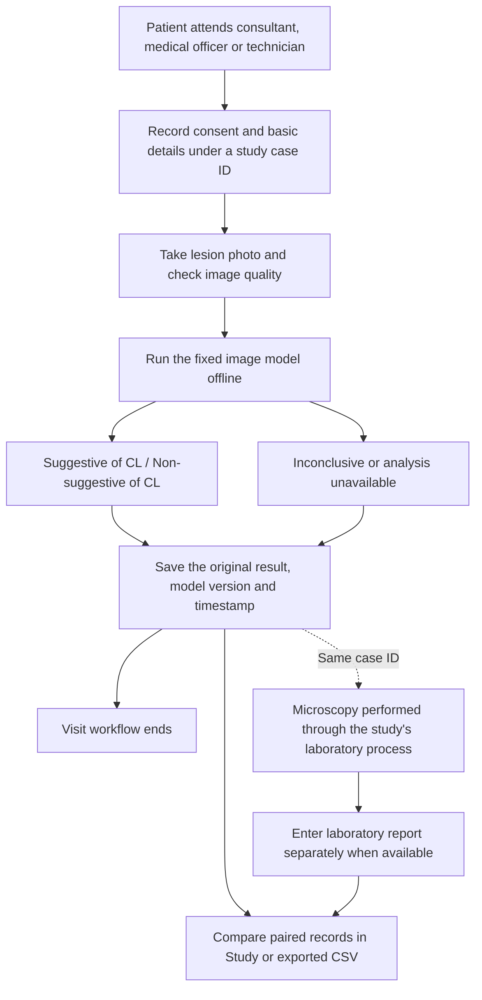

# CLARA feasibility-study workflow

Study focus: feasibility of an AI-powered offline mobile app to support community assessment of suspected cutaneous leishmaniasis.

There is no in-app referral, staff triage decision, treatment recommendation, or adaptive questionnaire. Optional clinical information is entered once with patient details and does not modify the image-model result. Microscopy entry is optional and takes place after case saving; it does not delay the patient-visit workflow. The laboratory test itself is outside CLARA.

## Recorded data

- Case ID, optional age/sex and clinical details, collection-permission timestamp, operator name/role/facility, photo and visual-quality check.
- Original model label, uncalibrated score, model version, last analysis-attempt start/end time and duration; explicit failure code/message when unavailable.
- Separate microscopy label (positive, negative, inconclusive), test date, optional laboratory and specimen/report ID, entry timestamp and staff attribution.

Saved model evidence cannot be overwritten through the app. The first microscopy entry is also retained without an edit action. This version has no laboratory correction/audit workflow: verify entries before saving and define a study correction procedure before data collection. These application guards are not tamper-proof storage or authentication.

Previous-workflow records migrate intact into a read-only archive and are excluded from feasibility calculations. All records remain exportable with eligibility flags. Export includes no photographs. Browser export downloads CSV; native export shares CSV text through the system share sheet.

## Descriptive comparison

The paired binary table uses only saved study cases with a completed model analysis labelled CL or NON_CL and a valid positive or negative microscopy entry. Model-inconclusive, failed, missing-microscopy and inconclusive-microscopy cases are counted separately and retained in the export.

| Measure | Calculation |
| --- | --- |
| Sensitivity against microscopy | TP / (TP + FN) |
| Specificity against microscopy | TN / (TN + FP) |
| Accuracy against microscopy | (TP + TN) / (TP + TN + FP + FN) |
| Positive predictive value | TP / (TP + FP) |
| Negative predictive value | TN / (TN + FN) |
| Balanced accuracy | (sensitivity + specificity) / 2 |

TP means suggestive model / positive microscopy; FN means non-suggestive / positive; TN means non-suggestive / negative; FP means suggestive / negative. Zero denominators display “Not available”. Multiple model versions can be filtered separately; the CSV always exports all records with version identifiers.

The app reports paired, descriptive point estimates without confidence intervals. It does not perform a formal study analysis. Inconclusive and missing outcomes need a prespecified analysis approach and explicit reporting; dropping them silently can bias reported performance. See the [STARD explanation and elaboration](https://pmc.ncbi.nlm.nih.gov/articles/5128957/).

## Study design decisions to settle before recruitment

The clinical research team should define eligibility, sample size, consent/ethics procedures, the diagnostic reference procedure, and handling of discordant or indeterminate findings. Keep the model and thresholds fixed during an evaluation cohort. Obtain the reference test according to the study protocol regardless of whether the app is suggestive or non-suggestive. Where practical, the laboratory reader should interpret microscopy without the model result; the app does not enforce blinding. Record exclusions and missing results. These items support transparent diagnostic-accuracy reporting under [STARD 2015](https://www.bmj.com/content/351/bmj.h5527).

Microscopy is a comparison test with limitations, not a perfect disease label. WHO describes variable microscopy sensitivity and the need for trained personnel in its [CL diagnostic target product profile](https://iris.who.int/bitstream/handle/10665/353980/9789240045224-eng.pdf). A negative result should therefore not be described as proof that CL is absent.

Feasibility also includes whether staff can complete the process offline, usable-photo rate, visit time, errors, usability and acceptability. CLARA currently records saved-case completion counts and last-attempt analysis time. These do not capture earlier retries, all abandoned visits, overall visit time, or staff usability. Collect those separately in the study protocol. Clinical validation, device testing, secure data handling and research oversight remain necessary.

## Current model behavior

The workflow change does not alter weights, preprocessing or decision thresholds. Existing CL scores above 0.8 are suggestive; below 0.2 are non-suggestive; the middle band is inconclusive. An empty lesion mask is inconclusive, and runtime failure has no model label. A binary-only study would require a separately prespecified and evaluated threshold policy; the app must not silently convert these failures into NON_CL.
